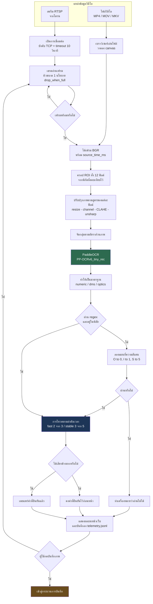
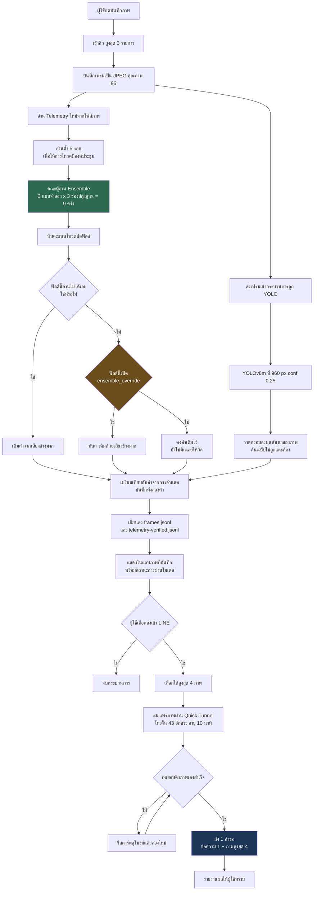
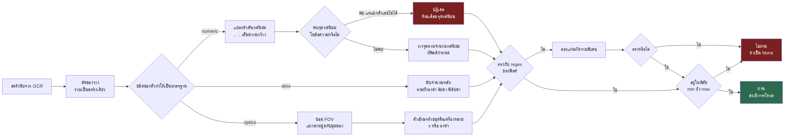

# รายงานทางเทคนิค
## การดึงข้อมูล Telemetry จากวิดีโอสตรีมของโดรนด้วย Object Detection และ PaddleOCR

**โครงการ:** telemetry-vision
**เวอร์ชันเอกสาร:** 1.0 — 23 สิงหาคม 2569
**สภาพแวดล้อมอ้างอิง:** Windows 11, Python 3.12, NVIDIA GTX 1650 (4 GB VRAM)

> **หมายเหตุเกี่ยวกับตัวเลขในเอกสารนี้**
> ตัวเลขความแม่นยำ เวลา และการใช้หน่วยความจำทั้งหมด เป็นค่าที่**วัดจากระบบจริง**บนเครื่องอ้างอิง
> ด้วยชุดข้อมูลที่ระบุไว้ในแต่ละหัวข้อ ไม่ใช่ค่าประมาณการหรือค่าที่อ้างจากเอกสารของผู้พัฒนาไลบรารี

---

## สารบัญ

1. [บทนำ](#1-บทนำ-introduction)
2. [ทฤษฎีที่เกี่ยวข้อง](#2-ทฤษฎีที่เกี่ยวข้อง-theoretical-background)
3. [สถาปัตยกรรมระบบและขั้นตอนการทำงาน](#3-สถาปัตยกรรมระบบและขั้นตอนการทำงาน-system-architecture--workflow)
4. [แผนผังการทำงานของระบบ (Flowchart)](#4-แผนผังการทำงานของระบบ-flowchart)
5. [ข้อควรระวังและปัจจัยที่มีผลต่อความแม่นยำ](#5-ข้อควรระวังและปัจจัยที่มีผลต่อความแม่นยำ-challenges--limitations)
6. [ภาคผนวก](#6-ภาคผนวก-appendix)

---

# 1. บทนำ (Introduction)

## 1.1 ภาพรวมของโครงการ

ระบบอากาศยานไร้คนขับ (**UAV / Drone**) ที่ใช้งานด้านการลาดตระเวนและการเฝ้าระวัง โดยทั่วไปจะส่งภาพวิดีโอ
จากกล้อง **EO/IR** (Electro-Optical / Infrared) กลับมายังสถานีภาคพื้นดินพร้อมกับ **ข้อมูลการบิน (Telemetry)**
ที่ถูก **ซ้อนทับ (overlay)** ลงบนภาพในรูปแบบข้อความ ซึ่งเรียกกันว่า **OSD (On-Screen Display)**

ข้อมูลเหล่านี้ประกอบด้วย พิกัดของอากาศยาน พิกัดของเป้าหมาย ระดับความสูง มุมกล้อง ระยะจากเครื่องวัดระยะด้วยเลเซอร์
และสถานะการซูมของกล้อง ซึ่งล้วนเป็นข้อมูลที่มีคุณค่าในการวิเคราะห์ภายหลังภารกิจ

**ปัญหาหลักคือ ข้อมูลเหล่านี้มาถึงในรูปของ "พิกเซล" ไม่ใช่ "ข้อมูล"** กล่าวคือ ตัวเลขทั้งหมดถูกวาดลงบนภาพ
ไปแล้วตั้งแต่ต้นทาง ผู้ใช้งานสามารถอ่านได้ด้วยตา แต่ไม่สามารถนำไปคำนวณ ค้นหา จัดเก็บลงฐานข้อมูล
หรือเชื่อมโยงกับผลการตรวจจับวัตถุโดยอัตโนมัติได้

โครงการ **telemetry-vision** จึงถูกพัฒนาขึ้นเพื่อ **แปลงข้อมูล Telemetry ที่อยู่ในรูปพิกเซล
กลับเป็นข้อมูลเชิงโครงสร้าง (Structured Data)** ที่เครื่องคอมพิวเตอร์ประมวลผลต่อได้ โดยอาศัย
**Optical Character Recognition (OCR)** ร่วมกับ **Object Detection** และกลไกการตรวจสอบความถูกต้องหลายชั้น

## 1.2 วัตถุประสงค์ของโครงการ

| ลำดับ | วัตถุประสงค์ | ตัวชี้วัด |
|:---:|---|---|
| 1 | สกัดข้อมูล Telemetry จำนวน **12 ฟิลด์** จากภาพวิดีโอโดยอัตโนมัติ | อัตราการอ่านสำเร็จต่อฟิลด์ |
| 2 | รองรับการทำงานแบบ **เรียลไทม์** จากสตรีม RTSP และแบบ **ออฟไลน์** จากไฟล์วิดีโอ | ความถี่ในการประมวลผล (Hz) |
| 3 | ตรวจจับและนับ **วัตถุเป้าหมาย** (ยานพาหนะ) ในภาพ พร้อมค่าความเชื่อมั่น | mAP, ค่า confidence รายคลาส |
| 4 | เชื่อมโยงข้อมูล Telemetry กับ **ภาพต้นฉบับ ณ ขณะนั้น** ได้อย่างตรวจสอบย้อนกลับได้ | ความสอดคล้องระหว่างภาพและค่า |
| 5 | ส่งผลลัพธ์ไปยังผู้ปฏิบัติงานผ่านช่องทางที่เข้าถึงง่าย (**LINE Messaging API**) | เวลาตั้งแต่กดบันทึกจนถึงข้อความ |
| 6 | ลด **ความผิดพลาดแบบเงียบ (Silent Error)** ซึ่งคือค่าที่ผิดแต่ดูสมเหตุสมผล | จำนวนค่าที่ผิดแต่ผ่านการตรวจสอบ |

> **วัตถุประสงค์ข้อที่ 6 คือหัวใจของโครงการ** ในงานด้าน Telemetry ค่าที่ **"อ่านไม่ออก"** นั้นไม่เป็นอันตราย
> เพราะผู้ใช้ทราบทันทีว่าไม่มีข้อมูล แต่ค่าที่ **"อ่านผิดแต่ดูถูกต้อง"** เป็นอันตรายอย่างยิ่ง เช่น ค่า
> `33.40°` ที่ถูกอ่านเป็น `3.40°` ยังคงเป็นตัวเลขที่อยู่ในพิสัยที่เป็นไปได้ ผ่านการตรวจสอบรูปแบบทุกข้อ
> และไม่มีสัญญาณใดบ่งชี้ว่าผิด การออกแบบทั้งระบบจึงให้น้ำหนักกับการ **"ปฏิเสธเมื่อไม่แน่ใจ"**
> มากกว่าการ **"เดาให้ได้คำตอบ"**

## 1.3 ประโยชน์ของการดึง Telemetry จากวิดีโอ

**1) การใช้ข้อมูลย้อนหลังโดยไม่ต้องแก้ไขระบบต้นทาง**
ระบบโดรนเชิงพาณิชย์และเชิงยุทธการจำนวนมากเป็น **ระบบปิด** ไม่เปิดช่องทางเข้าถึงข้อมูล Telemetry
ในรูปแบบดิจิทัล การอ่านจากภาพจึงเป็นวิธีเดียวที่ทำได้โดยไม่ต้องดัดแปลงอุปกรณ์หรือละเมิดเงื่อนไขการรับประกัน

**2) การเชื่อมโยงข้อมูลตำแหน่งกับวัตถุที่ตรวจพบ**
เมื่อทราบพิกัดของเป้าหมาย (TAG) ณ เฟรมที่ตรวจพบยานพาหนะ ระบบสามารถระบุได้ว่า
**"พบรถยนต์ 2 คัน ที่พิกัด 14°51'11.0"N 101°59'40.9"E"** ซึ่งเป็นข้อมูลที่นำไปใช้ได้ทันที
ต่างจากการมีเพียงภาพที่ตีกรอบไว้เฉย ๆ

**3) การจัดทำคลังข้อมูลที่ค้นหาได้**
ข้อมูลที่ถูกแปลงเป็น **JSONL** และ **CSV** สามารถนำไปสร้างดัชนี ค้นหาตามช่วงเวลา ตามพิกัด
หรือตามชนิดวัตถุที่พบ ซึ่งเป็นไปไม่ได้เลยหากข้อมูลยังอยู่ในรูปวิดีโอ

**4) การลดภาระของผู้ปฏิบัติงาน**
การถอดข้อมูลจากวิดีโอด้วยมือเป็นงานที่ใช้เวลาสูงและเกิดความผิดพลาดจากความล้าได้ง่าย
ระบบอัตโนมัติทำงานได้ที่ความถี่ประมาณ **10 ครั้งต่อวินาที** อย่างต่อเนื่อง

---

# 2. ทฤษฎีที่เกี่ยวข้อง (Theoretical Background)

## 2.1 การประมวลผลวิดีโอ (Video Frame Extraction)

### 2.1.1 หลักการพื้นฐาน

วิดีโอคือลำดับของ **ภาพนิ่ง (Frame)** ที่แสดงต่อเนื่องกันด้วยอัตราคงที่ การประมวลผลด้วยคอมพิวเตอร์วิทัศน์
จึงต้อง **สกัดเฟรมออกมาเป็นภาพเดี่ยว** ก่อนเสมอ ในทางปฏิบัติสิ่งที่ต้องพิจารณามีสามประการ

**ก. การถอดรหัส (Decoding)**
วิดีโอถูกบีบอัดด้วยตัวแปลงสัญญาณเช่น **H.264** หรือ **H.265** ซึ่งเก็บเฟรมส่วนใหญ่เป็น **ส่วนต่าง (Delta Frame)**
จากเฟรมก่อนหน้า ไม่ใช่ภาพเต็ม การเข้าถึงเฟรมใด ๆ จึงต้องถอดรหัสย้อนกลับไปถึง **Keyframe (I-Frame)**
ที่ใกล้ที่สุด ระบบนี้ใช้ **OpenCV** ซึ่งเรียกใช้ **FFmpeg** เป็นตัวถอดรหัสเบื้องหลัง

**ข. อัตราการสุ่มเฟรม (Sampling Rate)**
วิดีโอที่ 25–30 fps ไม่จำเป็นต้องถูกประมวลผลทุกเฟรม เนื่องจากข้อมูล OSD เปลี่ยนแปลงช้ากว่าอัตราเฟรมมาก
ระบบนี้กำหนดอัตราการประมวลผล OCR ไว้ที่ **10.1 Hz** ซึ่งเป็นค่าที่สมดุลระหว่างความต่อเนื่องของข้อมูล
กับภาระของหน่วยประมวลผลกราฟิก

**ค. การจัดการเวลา (Timing)**
เฟรมแต่ละเฟรมมี **ตราประทับเวลาของแหล่งข้อมูล (source_time_ms)** ซึ่งใช้อ้างอิงตำแหน่งในวิดีโอ
ค่านี้สำคัญต่อการเชื่อมโยงข้อมูล Telemetry กับภาพต้นฉบับได้อย่างถูกต้อง

### 2.1.2 ความแตกต่างระหว่างแหล่งข้อมูลสองประเภท

ระบบรองรับแหล่งข้อมูลสองแบบ ซึ่งมีลักษณะทางเทคนิคต่างกันอย่างมีนัยสำคัญ

| ประเด็น | ไฟล์วิดีโอ (Offline) | สตรีม RTSP (Realtime) |
|---|---|---|
| การเข้าถึงเฟรม | สุ่มเข้าถึงได้ ย้อนกลับได้ | ต่อเนื่องทางเดียว ย้อนกลับไม่ได้ |
| เฟรมที่หายไป | ไม่มี | เกิดขึ้นได้จากเครือข่าย |
| แรงกดดันด้านเวลา | ไม่มี ประมวลผลช้าได้ | มี หากช้าจะเกิดการสะสมของบัฟเฟอร์ |
| ผู้ควบคุมการอ่าน | เบราว์เซอร์ของผู้ใช้ | กระบวนการฝั่งเซิร์ฟเวอร์ |

**ประเด็นทางวิศวกรรมที่พบระหว่างการพัฒนา:** OpenCV รุ่นที่ใช้ **ไม่รองรับ** ตัวเลือกกำหนดเวลาหมดอายุ
ของ FFmpeg (`stimeout`, `rw_timeout`) ทำให้เมื่อกล้องไม่ตอบสนอง ระบบค้างอยู่ประมาณ **4 นาที**
ก่อนจะยอมแพ้ แก้ไขโดยใช้คุณสมบัติของ OpenCV โดยตรงคือ `CAP_PROP_OPEN_TIMEOUT_MSEC` และ
`CAP_PROP_READ_TIMEOUT_MSEC` ตั้งไว้ที่ **10 วินาที** ซึ่งเป็นทางเดียวที่ได้ผลจริงในสภาพแวดล้อมนี้

### 2.1.3 การเลือกรูปแบบการบันทึกภาพ

เมื่อผู้ใช้สั่งบันทึกเฟรม ระบบต้องเลือกระหว่างรูปแบบไฟล์ที่บีบอัดแบบ **ไม่สูญเสีย (PNG)**
กับแบบ **สูญเสีย (JPEG)** การทดสอบบนข้อมูลจริงจำนวน **2,340 ค่าที่อ่านได้** พบว่า

- **JPEG คุณภาพ 95** ให้ผลการอ่าน OCR **เหมือนกันทุกประการ** กับ PNG
- แต่ **เร็วกว่าประมาณ 3 เท่า** และใช้พื้นที่จัดเก็บน้อยกว่ามาก

ระบบจึงเลือกใช้ **JPEG คุณภาพ 95** โดยมีขนาดเฉลี่ยประมาณ **460 KB ต่อเฟรม** ที่ความละเอียด 1920×1080

---

## 2.2 การตรวจจับวัตถุ (Object Detection)

### 2.2.1 หลักการของ Object Detection

**Object Detection** คือปัญหาที่ต้องตอบสองคำถามพร้อมกัน ได้แก่ **"มีวัตถุอะไรอยู่ในภาพ" (Classification)**
และ **"อยู่ที่ตำแหน่งใด" (Localization)** ผลลัพธ์ที่ได้คือชุดของ **กรอบขอบเขต (Bounding Box)**
พร้อม **ป้ายชื่อคลาส** และ **ค่าความเชื่อมั่น (Confidence Score)**

สถาปัตยกรรมหลักแบ่งได้เป็นสองตระกูล

**ก. แบบสองขั้นตอน (Two-Stage Detector) — เช่น Faster R-CNN**
ขั้นแรกใช้ **Region Proposal Network (RPN)** เสนอบริเวณที่น่าจะมีวัตถุจำนวนหนึ่ง
ขั้นที่สองจึงจำแนกและปรับกรอบให้แม่นยำขึ้น วิธีนี้ให้ความแม่นยำสูงแต่ช้า
เพราะต้องประมวลผลบริเวณที่เสนอมาทีละส่วน

**ข. แบบขั้นตอนเดียว (One-Stage Detector) — เช่น YOLO และ SSD**
ทำนายคลาสและพิกัดกรอบพร้อมกันในการส่งผ่านเครือข่ายเพียงครั้งเดียว โดยแบ่งภาพเป็นตาราง
และให้แต่ละช่องรับผิดชอบทำนายวัตถุที่มีจุดศูนย์กลางอยู่ในช่องนั้น วิธีนี้เร็วกว่ามาก
จึงเหมาะกับงานที่ต้องการความเร็วระดับเรียลไทม์

| สถาปัตยกรรม | ประเภท | จุดเด่น | ข้อจำกัด |
|---|---|---|---|
| **Faster R-CNN** | Two-Stage | แม่นยำสูงกับวัตถุขนาดเล็ก | ช้า ไม่เหมาะกับเรียลไทม์ |
| **SSD** | One-Stage | เร็ว ใช้ feature map หลายระดับ | แม่นยำต่ำกว่ากับวัตถุขนาดเล็กมาก |
| **YOLO (v8)** | One-Stage | สมดุลความเร็วและความแม่นยำดีที่สุด | ต้องการข้อมูลฝึกฝนที่มีคุณภาพ |

### 2.2.2 บทบาทของ Object Detection ในโครงการนี้

> **ข้อชี้แจงที่สำคัญต่อความถูกต้องของเอกสาร**
> ในโครงการนี้ **Object Detection ไม่ได้ถูกใช้เพื่อค้นหาตำแหน่งของกล่องข้อความ Telemetry บนหน้าจอ**
> แต่ถูกใช้เพื่อ **ตรวจจับยานพาหนะในฉากที่กล้องมองเห็น** ตำแหน่งของกล่องข้อความมาจาก
> **การสอบเทียบ (Calibration) แบบกำหนดตายตัว** ซึ่งจะอธิบายในหัวข้อ 2.2.3
> เหตุผลของการเลือกออกแบบเช่นนี้อยู่ในหัวข้อ 2.2.4

**แบบจำลองที่ใช้งานจริง**

| คุณสมบัติ | ค่า |
|---|---|
| สถาปัตยกรรม | **YOLOv8m** (Ultralytics) |
| ไฟล์น้ำหนัก | `best.pt` (ประมาณ 52 MB) |
| จำนวนรอบการฝึก | 100 epochs |
| ขนาดภาพที่ฝึก | 640 × 640 พิกเซล |
| คลาสที่ตรวจจับ | `car`, `motorcycle`, `truck` |
| ตัวติดตามวัตถุ | **BoT-SORT** |
| อุปกรณ์ประมวลผล | CUDA (GPU) |

**การตั้งค่าที่แตกต่างกันระหว่างสองโหมดการทำงาน**

| พารามิเตอร์ | โหมดแสดงผลสด | โหมดบันทึกภาพ | เหตุผล |
|---|:---:|:---:|---|
| ขนาดภาพนำเข้า | 640 px | **960 px** | ภาพที่บันทึกมีเวลาให้ประมวลผลมากกว่า |
| ค่าความเชื่อมั่นขั้นต่ำ | 0.45 | **0.25** | แสดงกรอบที่ก้ำกึ่งพร้อมค่า conf ให้ผู้ใช้ตัดสินเอง |
| การติดตามข้ามเฟรม | เปิด (BoT-SORT) | ปิด | ภาพเดี่ยวไม่มีลำดับเวลาให้ติดตาม |

**หลักการสำคัญ: การตรวจจับต้องทำงานบนเฟรมที่ถูกบันทึกจริง**
ในเวอร์ชันแรกของระบบ เมื่อผู้ใช้กดบันทึกภาพ ระบบนำ **ผลการตรวจจับล่าสุด** ที่มีอยู่มาใช้
ซึ่งเป็นผลของ **เฟรมอื่น** ทำให้กรอบที่วาดไม่ตรงกับตำแหน่งยานพาหนะในภาพที่บันทึก
ปัจจุบันระบบส่งเฟรมที่บันทึกเข้าสู่แบบจำลองโดยตรงภายใต้รหัสแหล่งข้อมูลเฉพาะ (`capture-<uuid>`)
เพื่อไม่ให้รบกวนสถานะของตัวติดตามที่ใช้กับการแสดงผลสด ผลลัพธ์จึงมีค่า `age_ms = 0.0` เสมอ

**การรายงานสถานะสามระดับ**
ระบบแยกความหมายของ "ไม่พบวัตถุ" ออกเป็นสามสถานะ เนื่องจากทั้งสามมีวิธีแก้ไขคนละแบบ

| สถานะ | ความหมาย | การแก้ไข |
|---|---|---|
| `ready` | แบบจำลองทำงานแล้ว (รวมถึงกรณีทำงานแล้วไม่พบวัตถุ) | — |
| `no_model` | ยังไม่ได้โหลดแบบจำลอง | โหลด `best.pt` |
| `no_result` | แบบจำลองไม่ตอบสนองภายในเวลาที่กำหนด (20 วินาที) | ตรวจสอบสถานะ GPU |

### 2.2.3 การกำหนดตำแหน่ง ROI ด้วยการสอบเทียบ

ตำแหน่งของข้อความ Telemetry บนหน้าจอถูกกำหนดไว้ในไฟล์ตั้งค่า `roi_calibrated_cuda.yaml`
ในรูป **พิกัดแบบนอร์มัลไลซ์ (Normalized Coordinates)** คือค่าระหว่าง 0 ถึง 1 เทียบกับความกว้างและความสูงของภาพ
ทำให้ค่าตั้งค่าเดียวใช้ได้กับทุกความละเอียด

ตัวอย่างจากไฟล์ตั้งค่าจริง

```yaml
- field_id: sensor_angle_deg
  ensemble_override: true
  box: [0.475, 0.081, 0.078, 0.025]   # [x, y, width, height]
  regex: '^[+-]?\d{1,3}\.\d{2}$'
  data_type: float
  decimals: 2
  min_value: -180
  max_value: 180
  profile: fast
```

การสอบเทียบดำเนินการโดยโมดูล `calibration.py` ผ่านคำสั่ง `telemetry-ocr calibrate` ซึ่งทำงานดังนี้

1. **สุ่มเฟรมตัวอย่าง** จากไฟล์วิดีโอตามจำนวนที่กำหนดด้วย `--samples`
2. ทดลอง **สูตรการปรับปรุงภาพ (Preprocessing Recipe)** ทุกแบบกับ ROI ของทุกฟิลด์
3. บันทึกสถิติ ได้แก่ อัตราการผ่านการตรวจสอบ ค่าความเชื่อมั่นเฉลี่ย และเวลาที่ใช้
   หากมีไฟล์ **ค่าอ้างอิงที่กำกับด้วยมือ** (`--labels`) จะคำนวณ **อัตราความถูกต้องจริง** ได้ด้วย
4. เลือกสูตรที่ดีที่สุดเป็น **สูตรหลัก (primary)** และรองลงมาเป็น **สูตรสำรอง (fallback)** ของแต่ละฟิลด์
5. เขียนผลลัพธ์เป็นไฟล์ตั้งค่าใหม่ตามที่ระบุใน `--output-config` พร้อมรายงานสถิติใน `--report`

> ไฟล์ค่าอ้างอิงสำหรับขั้นตอนที่ 3 สร้างได้จากคำสั่ง `telemetry-ocr export-crops`
> ซึ่งส่งออกภาพครอปของแต่ละ ROI ให้นำไปอ่านและกำกับค่าที่ถูกต้องด้วยมือ

### 2.2.4 เหตุผลของการเลือก ROI แบบกำหนดตายตัวแทนการใช้ Detector

การใช้แบบจำลองตรวจจับเพื่อค้นหากล่องข้อความ (เช่น การใช้ **DBNet** ซึ่งเป็นส่วนตรวจจับข้อความของ PaddleOCR)
เป็นแนวทางที่ใช้กันทั่วไป แต่ในบริบทนี้มีข้อเสียเปรียบชัดเจน

| ประเด็น | ROI แบบกำหนดตายตัว | ROI จาก Text Detector |
|---|---|---|
| **ภาระการประมวลผล** | ครอปพิกเซลตามพิกัด แทบไม่มีต้นทุน | ต้องรันเครือข่ายทั้งภาพ 1920×1080 ทุกเฟรม |
| **ความเสถียรของตำแหน่ง** | คงที่เสมอ | อาจขยับหรือรวมกล่องติดกันเมื่อพื้นหลังเปลี่ยน |
| **การรู้บริบทของฟิลด์** | ทราบทันทีว่าเป็นฟิลด์ใด จึงใช้ regex เฉพาะได้ | ต้องอนุมานจากตำแหน่งภายหลัง |
| **การรองรับ OSD รูปแบบใหม่** | ต้องสอบเทียบใหม่ | รองรับได้ทันที |

**เหตุผลชี้ขาดคือข้อที่สาม** เมื่อระบบทราบล่วงหน้าว่ากล่องนี้คือฟิลด์ `lrf_m` ระบบจะสามารถ

- บังคับรูปแบบด้วย **นิพจน์ปกติ (Regular Expression)** ที่เจาะจง
- ตรวจสอบว่าค่าอยู่ในพิสัยที่เป็นไปได้ (`min_value` ถึง `max_value`)
- ใช้สูตรปรับปรุงภาพที่สอบเทียบมาเฉพาะสำหรับฟิลด์นั้น
- ใช้กลไกการโหวตตามเวลาด้วยโปรไฟล์ที่เหมาะกับอัตราการเปลี่ยนแปลงของฟิลด์นั้น

ความสามารถทั้งสี่ข้อนี้คือกลไกหลักที่ป้องกัน **ความผิดพลาดแบบเงียบ** ซึ่งเป็นวัตถุประสงค์ข้อที่ 6
เนื่องจาก OSD ของโดรนรุ่นที่ใช้งานมีตำแหน่งคงที่ ข้อได้เปรียบของ Text Detector ในการรองรับรูปแบบใหม่
จึงไม่คุ้มกับสิ่งที่ต้องแลกไป

---

## 2.3 การรู้จำอักขระด้วยแสง (Optical Character Recognition)

### 2.3.1 หลักการทั่วไปของ OCR สมัยใหม่

OCR ยุคปัจจุบันอาศัยโครงข่ายประสาทเทียมเชิงลึก และแบ่งงานออกเป็นสามส่วนหลัก

**1) การตรวจจับข้อความ (Text Detection)**
ค้นหาว่ามีข้อความอยู่บริเวณใดในภาพ ผลลัพธ์เป็นกรอบหรือรูปหลายเหลี่ยมล้อมรอบข้อความ

**2) การแก้ไขทิศทาง (Direction / Angle Classification)**
ตรวจสอบว่าข้อความกลับหัวหรือเอียงหรือไม่ แล้วหมุนให้อยู่ในแนวที่ถูกต้อง

**3) การรู้จำข้อความ (Text Recognition)**
แปลงภาพข้อความบรรทัดเดียวให้เป็นสตริงอักขระ ขั้นตอนนี้คือหัวใจของ OCR

### 2.3.2 สถาปัตยกรรมของ PaddleOCR

**PaddleOCR** เป็นชุดเครื่องมือ OCR แบบโอเพนซอร์สที่พัฒนาบนเฟรมเวิร์ก **PaddlePaddle**
จุดเด่นคือชุดแบบจำลองตระกูล **PP-OCR** ที่ออกแบบมาให้มีขนาดเล็กและเร็วพอสำหรับการใช้งานจริง

**โครงสร้างของสายประมวลผล PP-OCR แบบเต็ม**

```
ภาพนำเข้า
    │
    ├─► [1] Text Detection  (DBNet / DB++)
    │        └── ตรวจหาบริเวณข้อความ → ได้กรอบข้อความ
    │
    ├─► [2] Direction Classifier
    │        └── หมุนแก้ 0° / 180°
    │
    └─► [3] Text Recognition  (CRNN → SVTR_LCNet)
             └── ภาพบรรทัดเดียว → สตริงอักขระ + ค่าความเชื่อมั่น
```

**ส่วนที่ 1: Text Detection ด้วย DBNet**
**DBNet (Differentiable Binarization)** เป็นวิธี **Segmentation-based** ที่ทำนาย
**แผนที่ความน่าจะเป็น (Probability Map)** ของทุกพิกเซลว่าเป็นข้อความหรือไม่
นวัตกรรมสำคัญคือการทำ **Binarization ให้หาอนุพันธ์ได้** ทำให้ค่าขีดแบ่ง (threshold)
ถูกเรียนรู้ไปพร้อมกับเครือข่าย แทนที่จะกำหนดด้วยมือภายหลัง

**ส่วนที่ 3: Text Recognition**
สถาปัตยกรรมดั้งเดิมคือ **CRNN (Convolutional Recurrent Neural Network)** ประกอบด้วย

1. **ชั้น Convolution** สกัดคุณลักษณะจากภาพ แปลงเป็นลำดับของเวกเตอร์คุณลักษณะตามแนวนอน
2. **ชั้น Recurrent (BiLSTM)** จำลองความสัมพันธ์ตามลำดับของอักขระ
3. **ชั้น Transcription (CTC)** แปลงลำดับผลทำนายเป็นสตริงสุดท้าย

**CTC (Connectionist Temporal Classification)** เป็นกลไกที่แก้ปัญหาสำคัญคือ
**เราไม่ทราบว่าอักขระแต่ละตัวอยู่ที่คอลัมน์ใดของภาพ** CTC แก้ด้วยการเพิ่มสัญลักษณ์พิเศษ
**blank** และกำหนดกฎว่าผลทำนายที่ซ้ำกันติดกันให้ยุบเป็นตัวเดียว จากนั้นคำนวณความน่าจะเป็น
ของสตริงเป้าหมายโดยรวมทุกเส้นทางการจัดเรียงที่เป็นไปได้

> **CTC เกี่ยวข้องโดยตรงกับข้อผิดพลาดที่พบในโครงการนี้**
> เนื่องจากอักขระที่ซ้ำกันติดกันถูกยุบเป็นตัวเดียว การแยกแยะ `33` ออกจาก `3`
> จึงขึ้นอยู่กับว่าเครือข่ายทำนาย **blank** คั่นกลางระหว่างเลขสามทั้งสองตัวได้หรือไม่
> เมื่อภาพมีความคมชัดต่ำ เครือข่ายมักไม่ทำนาย blank ผลลัพธ์คือ `33.40` กลายเป็น `3.40`
> ซึ่งเป็นข้อผิดพลาดที่พบจริงและเป็นที่มาของกลไกในหัวข้อ 3.7

รุ่นหลังของ PP-OCR เปลี่ยนมาใช้ **SVTR_LCNet** ซึ่งแทนที่ชั้น Recurrent ด้วยกลไก
**Attention แบบ Transformer** ร่วมกับ CNN น้ำหนักเบา ทำให้เร็วขึ้นและแม่นยำขึ้นพร้อมกัน

### 2.3.3 การนำ PaddleOCR มาใช้ในโครงการนี้

**ระบบใช้เฉพาะส่วนรู้จำข้อความ (Recognition) เท่านั้น ไม่ใช้ส่วนตรวจจับ (Detection)**

| รายการ | ค่าที่ใช้ |
|---|---|
| แบบจำลอง | **`PP-OCRv6_tiny_rec`** |
| อุปกรณ์ | GPU (CUDA) |
| ขนาดชุดประมวลผล | 12 (เท่ากับจำนวนฟิลด์ทั้งหมด) |
| ความถี่การประมวลผล | 10.1 Hz |
| ค่าความเชื่อมั่นขั้นต่ำ | 0.65 |

เหตุผลที่ไม่ใช้ส่วน Detection คือระบบทราบตำแหน่งของทุกฟิลด์อยู่แล้วจากการสอบเทียบ
การรันเครือข่ายตรวจจับข้อความบนภาพเต็มทุกเฟรมจึงเป็นการใช้ทรัพยากรโดยไม่ได้ประโยชน์
การข้ามขั้นตอนนี้ทำให้ระบบทำงานได้ที่ 10 Hz บนการ์ดจอระดับ GTX 1650

**การจัดกลุ่มตามอัตราส่วนภาพ (Aspect Ratio Bucketing)**
แบบจำลองรู้จำข้อความต้องการภาพนำเข้าที่มีความสูงคงที่ ภาพที่มีอัตราส่วนต่างกันมากเมื่อถูกประมวลผล
ในชุดเดียวกันจะต้องเติมขอบ (padding) จำนวนมาก ซึ่งสิ้นเปลือง ระบบจึงจัดกลุ่ม ROI
ที่มีอัตราส่วนใกล้เคียงกันไว้ด้วยกันก่อนส่งเข้าแบบจำลอง (`aspect_bucket_base = 10.0`)

**ข้อจำกัดทางเทคนิคที่สำคัญ: ความขัดแย้งระหว่าง PaddlePaddle และ PyTorch**
บน Windows ไลบรารีทั้งสองเชื่อมโยงกับ **cuDNN คนละรุ่น** เมื่อถูกโหลดในกระบวนการเดียวกัน
จะเกิดข้อผิดพลาด `WinError 127` และระบบล้มเหลวทันที

**วิธีแก้ไข:** แยก YOLO (ซึ่งใช้ PyTorch) ออกไปทำงานใน **กระบวนการลูกแยกต่างหาก (Spawned Child Process)**
โดยกระบวนการหลักที่รัน PaddleOCR **จะต้องไม่ import torch โดยเด็ดขาด** ทั้งสองกระบวนการสื่อสารกัน
ผ่านการส่งข้อมูลภาพและผลลัพธ์ ซึ่งเป็นข้อจำกัดเชิงสถาปัตยกรรมที่ส่งผลต่อการออกแบบทั้งระบบ

---

# 3. สถาปัตยกรรมระบบและขั้นตอนการทำงาน (System Architecture & Workflow)

## 3.1 ภาพรวมสถาปัตยกรรม

ระบบแบ่งเป็นสามกระบวนการที่ทำงานแยกกัน เพื่อหลีกเลี่ยงความขัดแย้งของไลบรารีตามหัวข้อ 2.3.3

```
┌─────────────────────────────────────────────────────────────┐
│  กระบวนการหลัก (Main Process) — ห้าม import torch           │
│  ├── เว็บเซิร์ฟเวอร์ aiohttp (พอร์ต 8765)                    │
│  ├── สายประมวลผล OCR (PaddleOCR)                            │
│  ├── บริการจัดการสตรีม RTSP                                  │
│  └── ตัวจัดการเซสชันการบันทึกภาพ                             │
└──────────────────┬──────────────────────────────────────────┘
                   │ ส่งเฟรม / รับผลตรวจจับ
┌──────────────────▼──────────────────────────────────────────┐
│  กระบวนการลูก (Child Process) — YOLO / PyTorch              │
│  └── ตรวจจับวัตถุ + ติดตามด้วย BoT-SORT                      │
└─────────────────────────────────────────────────────────────┘
┌─────────────────────────────────────────────────────────────┐
│  กระบวนการเสริม (ตามต้องการ)                                 │
│  ├── เซิร์ฟเวอร์เผยแพร่ภาพชั่วคราว (พอร์ต 8766)              │
│  └── Cloudflare Quick Tunnel (สำหรับส่งภาพเข้า LINE)         │
└─────────────────────────────────────────────────────────────┘
```

## 3.2 ขั้นตอนที่ 1 — การรับข้อมูลวิดีโอ (Video Ingestion)

**กรณีสตรีม RTSP**

1. ระบบเปิดการเชื่อมต่อด้วย OpenCV โดยบังคับใช้ **TCP** แทน UDP เพื่อลดการสูญหายของแพ็กเก็ต
2. ตั้งเวลาหมดอายุการเชื่อมต่อและการอ่านไว้ที่ 10 วินาที
3. เธรดผู้อ่านดึงเฟรมอย่างต่อเนื่องเข้าสู่คิวขนาด 1 ด้วยนโยบาย **`drop_when_full`**
   กล่าวคือ หากประมวลผลไม่ทัน จะทิ้งเฟรมเก่าและใช้เฟรมใหม่เสมอ
   เพื่อไม่ให้ข้อมูลที่แสดงล้าหลังความเป็นจริง
4. ภาพถูกส่งไปยังเบราว์เซอร์ผ่าน **MJPEG (`multipart/x-mixed-replace`)**
   ซึ่งใช้การเชื่อมต่อเพียงครั้งเดียวต่อสตรีม ไม่ใช่หนึ่งครั้งต่อเฟรม

**กรณีไฟล์วิดีโอ**
เบราว์เซอร์เป็นผู้เล่นไฟล์และวาดเฟรมลง `<canvas>` จากนั้นส่งภาพมายังเซิร์ฟเวอร์เมื่อผู้ใช้สั่งบันทึก

## 3.3 ขั้นตอนที่ 2 — การกำหนดและครอป ROI

สำหรับแต่ละฟิลด์จากทั้งหมด 12 ฟิลด์

1. อ่านพิกัดแบบนอร์มัลไลซ์ `[x, y, w, h]` จากไฟล์ตั้งค่า
2. คูณด้วยขนาดจริงของเฟรมเพื่อให้ได้พิกัดพิกเซล
3. ขยายขอบเขตด้วย **padding** (ค่าเริ่มต้น 0.02 หรือ 2% ของขนาด ROI)
4. ครอปภาพส่วนนั้นออกมา

**หมายเหตุจากผลการทดลอง:** ค่า padding ที่มากขึ้นไม่ได้ให้ผลดีขึ้น การทดสอบกับฟิลด์มุมกล้อง
จำนวน 42 ภาพพบว่า padding 2% ให้ผลถูกต้อง 35 ค่า ขณะที่ 16% เหลือ 31 ค่า และ 35% เหลือเพียง 22 ค่า
เนื่องจากพื้นหลังที่ถูกดึงเข้ามาเพิ่มรบกวนการรู้จำมากกว่าที่ช่วย

## 3.4 ขั้นตอนที่ 3 — การปรับปรุงภาพก่อนประมวลผล (Pre-processing)

ภาพ ROI แต่ละภาพถูกแปลงตาม **สูตร (Recipe)** ที่สอบเทียบมาสำหรับฟิลด์นั้นโดยเฉพาะ
ลำดับการแปลงเป็นดังนี้

| ลำดับ | ขั้นตอน | รายละเอียด |
|:---:|---|---|
| 1 | **Resize** | ขยายภาพด้วย `INTER_CUBIC` (ค่าปกติคือ 2.0 เท่า) |
| 2 | **Channel Selection** | เลือกช่องสัญญาณสี |
| 3 | **CLAHE** | ปรับความเปรียบต่างเฉพาะพื้นที่แบบจำกัดการขยาย |
| 4 | **Unsharp Mask** | เพิ่มความคมชัดของขอบตัวอักษร |
| 5 | **Morphology** | Top-hat หรือ Black-hat เพื่อแยกวัตถุออกจากพื้นหลัง |
| 6 | **Threshold** | Otsu หรือ Adaptive Gaussian |
| 7 | **Invert** | กลับขาวดำ หากจำเป็น |

**ช่องสัญญาณสีที่รองรับ** ได้แก่ `color` (ภาพสีเดิม), `gray`, ช่องเดี่ยว `b`/`g`/`r`,
ช่องจากปริภูมิ **LAB** (`lab_l`, `lab_a`, `lab_b`) และช่องจากปริภูมิ **HSV** (`hsv_s`, `hsv_v`)

> **ความสำคัญของการเลือกช่องสัญญาณ**
> ข้อความ OSD ของโดรนรุ่นนี้เป็น **สีเขียวอิ่มตัวสูง** ซึ่งมักถูกวาดทับบน **พืชพรรณสีเขียว**
> ทั้งสองมี **ค่าความสว่าง (Luminance) ใกล้เคียงกันมาก** ทำให้ช่อง `gray` และภาพสีปกติ
> แทบแยกตัวอักษรออกจากพื้นหลังไม่ได้ แต่ **ช่องความอิ่มตัวของสี (`hsv_s`)** แยกได้อย่างชัดเจน
> เพราะข้อความอิ่มตัวเต็มที่ ส่วนใบไม้ไม่อิ่มตัว หลักการนี้เป็นพื้นฐานของกลไกในหัวข้อ 3.7

## 3.5 ขั้นตอนที่ 4 — การรู้จำข้อความและการตรวจสอบความถูกต้อง

**ก. การรู้จำ**
ภาพที่ผ่านการปรับปรุงแล้วทั้ง 12 ภาพถูกจัดกลุ่มตามอัตราส่วนและส่งเข้า `PP-OCRv6_tiny_rec`
เป็นชุดเดียว ผลลัพธ์คือสตริงข้อความและค่าความเชื่อมั่นของแต่ละฟิลด์

**ข. สูตรสำรอง (Fallback)**
หากผลจากสูตรหลัก **ไม่ผ่านการตรวจสอบ** หรือ **มีค่าความเชื่อมั่นต่ำกว่า 0.65**
ระบบจะประมวลผลซ้ำด้วยสูตรสำรอง แล้วเลือกผลที่ดีกว่า

**ค. การทำให้เป็นมาตรฐาน (Normalization)**
สตริงดิบถูกแปลงตามชนิดของข้อมูล ตัวอย่างของการซ่อมแซมที่ระบบทำ

| ชนิด | ปัญหาที่พบจริง | การซ่อมแซม |
|---|---|---|
| `numeric` | `533：6` (ทวิภาคเต็มความกว้าง) | แปลงเป็น `533.6` |
| `dms` | เครื่องหมายฟิลิปดาถูกอ่านเป็นเลข `2` ต่อท้าย | ตัดทิ้งเมื่อเป็นหลักเกินเพียงหลักเดียว |
| `optics` | `12.8xFOV58a` (เครื่องหมายองศาเป็นตัวอักษร) | สร้างใหม่เป็น `12.8xFOV5.8°` |

**ง. การตรวจสอบด้วยนิพจน์ปกติและพิสัยค่า**
ค่าที่ผ่านการทำให้เป็นมาตรฐานต้องตรงกับ **regex** ของฟิลด์ และอยู่ในช่วง `min_value`–`max_value`

**จ. แผนที่ความสับสนของอักขระ (Confusion Map)**
หากยังไม่ผ่าน ระบบลองครั้งที่สองโดยแทนที่อักขระที่มักถูกอ่านสลับกัน
เช่น `O`→`0`, `I`→`1`, `S`→`5`, `B`→`8`

## 3.6 ขั้นตอนที่ 5 — การโหวตตามลำดับเวลา (Temporal Voting)

ค่าที่อ่านได้จากเฟรมเดียวยังไม่ถูกเผยแพร่ทันที แต่ต้องผ่าน **การโหวตข้ามเฟรม**

| โปรไฟล์ | หน้าต่าง | ต้องตรงกัน | ใช้กับฟิลด์ |
|---|:---:|:---:|---|
| **`fast`** | 3 เฟรม | 2 เฟรม | ฟิลด์ที่เปลี่ยนเร็ว เช่น มุมกล้อง พิกัด |
| **`stable`** | 5 เฟรม | 3 เฟรม | ฟิลด์ที่เปลี่ยนช้า เช่น เวลา |

กลไกนี้กรอง **ข้อผิดพลาดที่เกิดเพียงครั้งเดียว** ออกไปได้อย่างมีประสิทธิภาพ
เนื่องจากการอ่านผิดแบบสุ่มมักไม่เกิดซ้ำในเฟรมถัดไปด้วยค่าเดียวกัน

**ผลข้างเคียงที่ต้องเข้าใจ:** การโหวตทำให้ค่าที่เผยแพร่ **ล้าหลังภาพจริงเล็กน้อยโดยเจตนา**
การวัดบนสตรีมจริงพบว่า ข้อความ OCR ตรงกัน 10 จาก 11 ฟิลด์ ขณะที่ค่าที่เผยแพร่ต่างกัน 8 จาก 11 ฟิลด์
ซึ่ง **ไม่ใช่ความผิดพลาด** แต่คือการโหวตที่ยังยึดค่าที่ยืนยันแล้วจากเฟรมก่อนหน้า

## 3.7 ขั้นตอนที่ 6 — การบันทึกภาพและการตรวจสอบซ้ำด้วยคณะผู้อ่าน (Ensemble)

เมื่อผู้ใช้กดปุ่มบันทึก ระบบทำงานตามลำดับนี้ **แบบซิงโครนัส** กล่าวคือ
คำขอจะไม่ตอบกลับจนกว่าทุกขั้นตอนจะเสร็จสิ้น

1. บันทึกเฟรมเป็นไฟล์ JPEG คุณภาพ 95
2. ส่งเฟรมเข้า YOLO เพื่อตรวจจับวัตถุ พร้อมวาดกรอบลงบน **สำเนา** ของภาพ
3. **อ่านค่า Telemetry ใหม่จากไฟล์ภาพที่บันทึกไว้** ไม่ใช่จากหน่วยความจำ
4. เปรียบเทียบผลกับค่าจากการอ่านสด แล้วบันทึกทั้งสองค่า

**เหตุผลของขั้นตอนที่ 3** ภาพที่ถูกบันทึกกับค่าที่การโหวตเผยแพร่อยู่ อาจไม่ใช่เฟรมเดียวกัน
การอ่านซ้ำจากไฟล์เป็นวิธีเดียวที่รับประกันได้ว่าตัวเลข **อธิบายภาพใบนี้จริง**

### กลไกคณะผู้อ่าน (Ensemble) — การแก้ปัญหา "ผิดแต่มั่นใจ"

ปัญหาที่ยากที่สุดคือกรณีที่แบบจำลองอ่านผิดด้วยค่าความเชื่อมั่นสูง เช่น
อ่าน ROI ที่แสดง `33.40` เป็น `3.40` ด้วยความเชื่อมั่น **0.91** ซึ่งไม่มีกลไกใดในระบบมีเหตุผลให้สงสัย

**วิธีแก้:** อ่านภาพเดียวกันด้วย **แบบจำลอง 3 ตัว × ช่องสัญญาณ 3 ช่อง = 9 ครั้ง** แล้วนับคะแนนโหวต

**ผลการวัด** (ชุดข้อมูล: ROI ฟิลด์มุมกล้องจาก 42 ภาพที่บันทึกไว้ พร้อมเฉลยที่อ่านด้วยสายตา)

| การตั้งค่า | ถูกต้อง | ผิด | อ่านไม่ได้ |
|---|:---:|:---:|:---:|
| 1 แบบจำลอง × 1 ช่องสัญญาณ (เดิม) | 35/42 | 4 | 3 |
| 1 แบบจำลอง × 3 ช่องสัญญาณ | 38/42 | 4 | 0 |
| 3 แบบจำลอง × 1 ช่องสัญญาณ | 35/42 | 6 | 1 |
| 3 แบบจำลอง × 2 ช่องสัญญาณ | 37/42 | 5 | 0 |
| **3 แบบจำลอง × 3 ช่องสัญญาณ** | **40/42** | **2** | **0** |

**ข้อค้นพบที่สำคัญ:** แบบจำลองเสริมทั้งสองตัว (`en_PP-OCRv5_mobile_rec`, `en_PP-OCRv4_mobile_rec`)
เมื่อใช้งาน **เดี่ยว ๆ ให้ผลแย่กว่ามาก** คือ 26/42 และ 21/42 ตามลำดับ
แต่กลับ **มีคุณค่าสูงในฐานะผู้โหวต** เพราะข้อผิดพลาดของแต่ละตัวเป็นอิสระต่อกัน
ข้อสรุปนี้ขัดกับสมมติฐานเริ่มต้นที่ว่า "ใช้แบบจำลองใหญ่ขึ้นน่าจะดีขึ้น" ซึ่งข้อมูลปฏิเสธอย่างชัดเจน

### ขอบเขตการใช้งานของ Ensemble

เมื่อทดลองให้ Ensemble ทับค่าเดิมได้ **ทุกฟิลด์** พบว่าฟิลด์มุมก้มเงย (`elevation_deg`) **แย่ลงอย่างชัดเจน**
โดยเฉพาะการ **ทำเครื่องหมายลบหายไป** เช่น `-8.75` กลายเป็น `8.75` และ `-24.96` กลายเป็น `24.96`

เนื่องจากมีเพียงฟิลด์เดียวที่มีเฉลยให้วัด ระบบจึงกำหนดนโยบายดังนี้

| ขอบเขต | พฤติกรรม | เหตุผล |
|---|---|---|
| **ทุกฟิลด์** | เติมเฉพาะช่องที่อ่านไม่ได้เลย | ไม่มีค่าเดิมให้ทำเสียหาย |
| **`sensor_angle_deg` เท่านั้น** | ทับค่าเดิมได้ (`ensemble_override: true`) | มีการวัดยืนยันแล้ว |

ผลรวมจาก 45 ภาพที่บันทึกไว้: **เติมค่าที่ว่าง 33 ค่า** และ **เปลี่ยนค่าเดิม 10 ค่า
ซึ่งทั้งหมดอยู่ในฟิลด์ที่ผ่านการวัดแล้วเท่านั้น**

**ต้นทุนของกลไกนี้**

| รายการ | ค่า |
|---|---|
| หน่วยความจำ GPU เพิ่มเติม | +125 MiB |
| เวลาต่อ ROI | 3 ms → 30 ms |
| การบันทึกภาพครั้งแรกของแต่ละรอบ | ประมาณ 4.7 วินาที (โหลดแบบจำลอง) |
| การบันทึกภาพครั้งถัดไป | ประมาณ 0.8 วินาที |
| ผลกระทบต่อการทำงานแบบเรียลไทม์ | **ไม่มี** |

## 3.8 ขั้นตอนที่ 7 — การส่งออกข้อมูล (Post-processing & Output)

**ก. โครงสร้างไฟล์ของหนึ่งเซสชัน**

```
output/sessions/<ชื่อเซสชัน>/
├── session.json               ข้อมูลกำกับเซสชัน
├── frames.jsonl               บัญชีรายการเฟรม หนึ่งบรรทัดต่อหนึ่งภาพ
├── telemetry.jsonl            ค่าที่อ่านได้จากการอ่านสด
├── telemetry-verified.jsonl   ค่าที่อ่านซ้ำจากไฟล์ภาพ
├── frames/
│   ├── 00000000.jpg           ภาพต้นฉบับ
│   └── 00000000.boxes.jpg     สำเนาที่วาดกรอบตรวจจับแล้ว
└── thumbs/                    ภาพย่อสำหรับแสดงผล
```

> **หลักการออกแบบ:** ภาพต้นฉบับจะ **ไม่ถูกวาดทับเด็ดขาด** เพราะเป็นทั้งหลักฐานและเป็นภาพที่ใช้
> อ่าน OCR ซ้ำ หากกรอบตรวจจับพาดผ่านข้อความ OSD จะทำให้การอ่านซ้ำผิดพลาด

**ข. รูปแบบข้อความที่ส่งเข้า LINE**

```
[Capture] 2026-08-22T08:41:30.659+00:00
session-20260822-154015 · frames/00000002.jpg

ACFT  14°50'57.8"N   101°59'48.7"E   ALT 438 m
TAG   14°51'11.0"N   101°59'40.9"E   ALT 231 m
CAM   yaw 33.40°   pitch -29.33°
LRF   622.5 m
SENS  EO 1.0xFOV7.2°   IR 1.0x

      TAG on map: https://www.google.com/maps?q=14.853056,101.994681

ตรวจจับได้: car 2 (conf 0.84) (รวม 2)
รูป: output\sessions\session-20260822-154015\frames\00000002.boxes.jpg
```

**ค. ข้อจำกัดของ LINE Messaging API และผลต่อการออกแบบ**

| ข้อจำกัด | ผลต่อการออกแบบ |
|---|---|
| ไม่รองรับการอัปโหลดไฟล์ภาพโดยตรง | ต้องเผยแพร่ภาพผ่าน **HTTPS สาธารณะ** ให้เซิร์ฟเวอร์ของ LINE ดึงเอง |
| หนึ่งคำขอส่งได้สูงสุด **5 ข้อความ** | ส่งได้สูงสุด **4 ภาพ** ต่อครั้ง (ข้อความแรกคือ Telemetry) |
| นับโควตาตาม **จำนวนคำขอ** ไม่ใช่จำนวนข้อความ | รวมทุกอย่างไว้ในคำขอเดียวเพื่อประหยัดโควตา |

การเผยแพร่ภาพใช้ **Cloudflare Quick Tunnel** ร่วมกับเซิร์ฟเวอร์ภายในที่ให้บริการเฉพาะเส้นทางเดียว
โดยใช้ **โทเค็นความยาว 43 อักขระ** และมี **อายุ 10 นาที**

> **บทเรียนทางเทคนิค:** `cloudflared` พิมพ์ URL ออกมา **ก่อน** ที่การเชื่อมต่อจะพร้อมใช้งานจริง
> ทำให้ LINE ดึงภาพไม่สำเร็จและแสดงภาพเสียถาวร (เพราะ LINE ดึงเพียงครั้งเดียวแล้วแคชไว้)
> แก้ไขโดยรอสัญญาณ `Registered tunnel connection` และ **ทดสอบดึงภาพด้วยตนเองก่อนส่ง**

---

# 4. แผนผังการทำงานของระบบ (Flowchart)

## 4.1 แผนผังภาพรวมของระบบ



## 4.2 แผนผังกระบวนการบันทึกภาพและตรวจสอบซ้ำ



## 4.3 แผนผังการตัดสินใจของกลไกตรวจสอบความถูกต้อง



---

# 5. ข้อควรระวังและปัจจัยที่มีผลต่อความแม่นยำ (Challenges & Limitations)

## 5.1 ความเปรียบต่างระหว่างข้อความกับพื้นหลัง

**ระดับความรุนแรง: สูงที่สุด**

**ลักษณะปัญหา:** ข้อความ OSD เป็นสีเขียวอิ่มตัว ซึ่งเมื่อกล้องเล็งไปยังพื้นที่ป่าหรือทุ่งหญ้า
จะมี **ค่าความสว่างใกล้เคียงกับพื้นหลังมาก** แม้ตาเปล่าจะแยกออกได้จากความอิ่มตัวของสี
แต่แบบจำลองที่ทำงานบนภาพระดับสีเทาแทบแยกไม่ออก

**หลักฐานเชิงประจักษ์:** จากการวิเคราะห์ 42 ภาพ ความผิดพลาดของฟิลด์มุมกล้อง **กระจุกตัว
อยู่ที่เฟรมที่ OSD ทับพื้นที่พืชพรรณเกือบทั้งหมด** ขณะที่เฟรมที่มีพื้นหลังสว่าง เช่น ถนนหรือท้องฟ้า
อ่านได้ถูกต้องเกือบทุกเฟรม

**แนวทางแก้ไขที่ใช้จริง**

1. ใช้ **ช่องความอิ่มตัวของสี (`hsv_s`)** เป็นหนึ่งในช่องสัญญาณของ Ensemble
2. ใช้ **CLAHE** เพื่อดึงความเปรียบต่างเฉพาะพื้นที่
3. ใช้ **การโหวตข้ามช่องสัญญาณ** เพื่อให้ช่องที่มองเห็นเป็นผู้ตัดสิน

## 5.2 ความผิดพลาดแบบเงียบ (Silent Error)

**ระดับความรุนแรง: สูงที่สุด**

**ลักษณะปัญหา:** ค่าที่อ่านผิดแต่ยังคงมีรูปแบบถูกต้องและอยู่ในพิสัยที่เป็นไปได้
จึงผ่านการตรวจสอบทุกด่านและถูกรายงานว่า **ยืนยันแล้ว**

**กรณีตัวอย่างที่พบจริง**

| ฟิลด์ | ค่าจริง | ค่าที่อ่านได้ | สาเหตุ |
|---|---|---|---|
| `sensor_angle_deg` | `33.40` | `3.40` | CTC ยุบเลข 3 ที่ซ้ำกันเป็นตัวเดียว |
| `lrf_m` | `646.0` | `64.6` | อ่าน `0` เป็น `O` แล้วระบบเลื่อนจุดทศนิยมเอง |
| `lrf_m` | `533.6` | `53.3` | ตัวคั่นทศนิยมเป็นอักขระเต็มความกว้าง |

**แนวทางแก้ไขที่ใช้จริง**

1. **ห้ามเลื่อนจุดทศนิยมที่ระบบมองเห็นแล้ว** หากพบจุดทศนิยมในข้อความแต่แยกตัวเลขไม่ได้
   ให้ **ปฏิเสธทั้งเฟรม** ดีกว่ารายงานค่าที่ผิดสิบเท่า
2. ใช้ **กลไก Ensemble** สำหรับฟิลด์ที่มีเฉลยยืนยันแล้ว
3. เปิดเผย **ข้อความดิบ (raw text)** และ **ค่าความเชื่อมั่น** ให้ผู้ใช้เห็นทุกฟิลด์
4. ให้ผู้ใช้ **ขยายภาพที่บันทึกทับพื้นที่วิดีโอ** เพื่อตรวจสอบด้วยตาเทียบกับค่าที่ระบบอ่านได้

> **หลักการที่ยึดถือ:** ค่าที่ว่างเปล่าคือความซื่อสัตย์ ค่าที่ผิดคือความเสียหาย
> เมื่อต้องเลือกระหว่างสองอย่าง ระบบเลือกอย่างแรกเสมอ

## 5.3 ความเบลอจากการเคลื่อนไหว (Motion Blur)

**ระดับความรุนแรง: ปานกลาง**

**ลักษณะปัญหา:** เมื่อโดรนเลี้ยวหรือกล้องหมุนอย่างรวดเร็ว ภาพจะเบลอ
แม้ข้อความ OSD จะถูกวาดทับหลังการบีบอัด แต่การบีบอัดวิดีโอที่บิตเรตต่ำในฉากที่เคลื่อนไหวมาก
จะทำให้เกิด **สิ่งแปลกปลอมจากการบีบอัด (Compression Artifact)** รอบตัวอักษร

**แนวทางแก้ไข**

1. **การโหวตตามลำดับเวลา** กรองเฟรมที่เบลอออกได้โดยธรรมชาติ
   เพราะเฟรมเบลอมักให้ผลที่ไม่ซ้ำกับเฟรมอื่น
2. ใช้ **Unsharp Mask** ในขั้นตอนปรับปรุงภาพ
3. **บันทึกภาพในจังหวะที่ภาพนิ่ง** ซึ่งเป็นข้อได้เปรียบของการให้ผู้ใช้กดบันทึกเอง

## 5.4 ความละเอียดของวิดีโอและขนาดของตัวอักษร

**ระดับความรุนแรง: ปานกลาง**

**ลักษณะปัญหา:** ระบบสอบเทียบกับวิดีโอ 1920×1080 ซึ่งตัวอักษร OSD สูงประมาณ 25 พิกเซล
หากสตรีมถูกลดความละเอียดลงเหลือ 1280×720 ตัวอักษรจะเหลือเพียงประมาณ 17 พิกเซล
ซึ่งต่ำกว่าระดับที่แบบจำลองทำงานได้ดี

**แนวทางแก้ไข**

1. พิกัด ROI เป็นแบบ **นอร์มัลไลซ์** จึงยังชี้ตำแหน่งถูกต้องทุกความละเอียด
2. ขั้นตอน **Resize ด้วย `INTER_CUBIC`** ขยายภาพ 2 เท่าก่อนส่งเข้าแบบจำลอง
3. หากใช้กับความละเอียดที่ต่างจากเดิมมาก **ควรสอบเทียบใหม่**

## 5.5 การเปลี่ยนรูปแบบของ OSD

**ระดับความรุนแรง: สูง (แต่เกิดไม่บ่อย)**

**ลักษณะปัญหา:** ระบบผูกกับตำแหน่งและรูปแบบของ OSD ที่สอบเทียบไว้
หากมีการอัปเดตเฟิร์มแวร์ของโดรนที่ย้ายตำแหน่งหรือเปลี่ยนรูปแบบตัวเลข
ระบบจะอ่านไม่ได้ทั้งหมด

**แนวทางแก้ไข**

1. รัน **กระบวนการสอบเทียบใหม่** ซึ่งเป็นคำสั่งที่มีอยู่แล้วในระบบ
2. เนื่องจากระบบ **ปฏิเสธเมื่อไม่ตรงรูปแบบ** ปัญหานี้จะแสดงออกเป็น
   "อ่านไม่ได้ทุกฟิลด์" ซึ่งสังเกตเห็นได้ทันที ไม่ใช่ค่าที่ผิดแบบเงียบ

## 5.6 ข้อจำกัดด้านทรัพยากรและสภาพแวดล้อม

| ข้อจำกัด | รายละเอียด | การจัดการ |
|---|---|---|
| **หน่วยความจำ GPU** | GTX 1650 มี VRAM เพียง 4 GB | OCR ทั้ง 3 แบบจำลองใช้เพียง 125 MiB, YOLO แยกกระบวนการ |
| **ความขัดแย้ง cuDNN** | Paddle และ PyTorch ใช้ cuDNN คนละรุ่น | แยกกระบวนการเด็ดขาด ห้าม import torch ในกระบวนการหลัก |
| **การเข้าถึง PaddleOCR** | ไม่ปลอดภัยต่อการเรียกพร้อมกันหลายเธรด | ใช้ล็อกระดับกระบวนการ (`threading.Lock`) |
| **โควตา LINE** | นับตามจำนวนคำขอต่อเดือน | จำกัดอัตราฝั่งเซิร์ฟเวอร์ที่ 3 วินาทีต่อครั้ง + รวมภาพในคำขอเดียว |
| **การเข้ารหัสอักขระบน Windows** | คอนโซลใช้ code page 874 | หลีกเลี่ยงอักขระพิเศษในข้อความที่พิมพ์ออกคอนโซล |

## 5.7 ข้อจำกัดที่ยังคงอยู่และแนวทางพัฒนาต่อ

| ข้อจำกัด | สถานะปัจจุบัน | แนวทางแก้ไข |
|---|---|---|
| ฟิลด์ 11 จาก 12 ฟิลด์ยังไม่มีเฉลยสำหรับวัด | Ensemble เติมได้เฉพาะค่าที่ว่าง | จัดทำเฉลยด้วยการอ่านภาพครอปด้วยสายตา แล้ววัดทีละฟิลด์ |
| `lrf_m` บางเฟรมยังอ่านผิด | พบว่า Ensemble โหวตได้ถูกต้อง แต่ยังไม่เปิดใช้ | ต้องมีเฉลยยืนยันก่อนเปิด `ensemble_override` |
| แบบจำลองต้องโหลดใหม่ทุกครั้งที่รีสตาร์ต | ผู้ใช้ต้องอัปโหลด `best.pt` ด้วยตนเอง | พิจารณาโหลดอัตโนมัติ (ต้องประเมินความเสี่ยงของการโหลดไฟล์ pickle) |
| การบันทึกภาพครั้งแรกใช้เวลา 4.7 วินาที | โหลดแบบจำลอง Ensemble แบบ lazy | โหลดล่วงหน้าในเบื้องหลังขณะเริ่มระบบ |
| ยังไม่รองรับ OSD หลายรูปแบบพร้อมกัน | หนึ่งไฟล์ตั้งค่าต่อหนึ่งรูปแบบ | เพิ่มกลไกเลือกไฟล์ตั้งค่าอัตโนมัติจากลักษณะภาพ |

---

# 6. ภาคผนวก (Appendix)

## 6.1 รายการฟิลด์ Telemetry ทั้งหมด

| ฟิลด์ | ความหมาย | ชนิด | โปรไฟล์ | ช่องสัญญาณหลัก |
|---|---|---|---|---|
| `timestamp` | วันและเวลา | string | stable | color |
| `eo_detail` | กำลังขยายและมุมมองกล้อง EO | string | fast | color |
| `ir_detail` | กำลังขยายกล้อง IR | string | fast | color |
| `lrf_m` | ระยะจากเครื่องวัดระยะเลเซอร์ (เมตร) | float | fast | color |
| `sensor_angle_deg` | มุมส่ายกล้อง ซ้าย–ขวา (องศา) | float | fast | color |
| `elevation_deg` | มุมก้ม–เงยกล้อง (องศา) | float | fast | color |
| `tag_lat_dms` | ละติจูดเป้าหมาย | dms | fast | color |
| `tag_lon_dms` | ลองจิจูดเป้าหมาย | dms | fast | color |
| `tag_alt_m` | ความสูงเป้าหมาย (เมตร) | float | fast | color |
| `acft_lat_dms` | ละติจูดอากาศยาน | dms | fast | gray |
| `acft_lon_dms` | ลองจิจูดอากาศยาน | dms | fast | color |
| `acft_alt_m` | ความสูงอากาศยาน (เมตร) | float | fast | color |

## 6.2 สรุปผลการปรับปรุงความแม่นยำที่วัดได้

| ฟิลด์ / กลไก | ก่อนปรับปรุง | หลังปรับปรุง | ชุดข้อมูลที่ใช้วัด |
|---|:---:|:---:|---|
| `eo_detail` (ผ่านการตรวจสอบ) | 35.1% | **78.4%** | 74 ค่าที่อ่านได้ |
| `ir_detail` (ผ่านการตรวจสอบ) | 54.1% | **97.3%** | 74 ค่าที่อ่านได้ |
| `sensor_angle_deg` (ถูกต้องจริง) | 35/42 | **40/42** | 42 ภาพพร้อมเฉลย |
| จำนวนฟิลด์ที่อ่านได้ทั้งระบบ | 468/516 | **497/516** | 43 ภาพ × 12 ฟิลด์ |
| `lrf_m` (ค่าที่ผิดสิบเท่า) | 3 ค่า | **0 ค่า** | 74 ค่าที่อ่านได้ |

## 6.3 สภาพแวดล้อมและไลบรารีที่ใช้

| รายการ | เวอร์ชัน / รายละเอียด |
|---|---|
| ระบบปฏิบัติการ | Windows 11 |
| ภาษา | Python 3.12 |
| OCR | PaddleOCR (`PP-OCRv6_tiny_rec`) บน PaddlePaddle |
| Object Detection | Ultralytics YOLOv8m + BoT-SORT |
| ประมวลผลภาพ | OpenCV 4.10 |
| เว็บเซิร์ฟเวอร์ | aiohttp |
| หน่วยประมวลผลกราฟิก | NVIDIA GTX 1650 (4 GB, Compute Capability 7.5) |
| การทดสอบ | pytest (341 กรณีทดสอบ), ruff, mypy, node --test |

## 6.4 คำสั่งที่ใช้บ่อย

เริ่มเว็บเซิร์ฟเวอร์

```bash
telemetry-ocr web --config configs/roi_calibrated_cuda.yaml --host 127.0.0.1 --port 8765
```

สกัดข้อมูลจากเซสชันที่บันทึกไว้แบบออฟไลน์

```bash
telemetry-ocr extract --session output/sessions/<ชื่อเซสชัน> --config configs/roi_calibrated_cuda.yaml --jsonl out.jsonl --csv out.csv
```

สอบเทียบสูตรปรับปรุงภาพใหม่ แล้วเขียนผลลงไฟล์ตั้งค่าใหม่

```bash
telemetry-ocr calibrate --video <ไฟล์วิดีโอ> --config configs/roi_calibrated_cuda.yaml --output-config configs/roi_new.yaml --samples 200 --labels labels.csv --report report.json
```

ส่งออกภาพครอปของ ROI เพื่อนำไปกำกับค่าอ้างอิงด้วยมือ

```bash
telemetry-ocr export-crops --video <ไฟล์วิดีโอ> --config configs/roi_calibrated_cuda.yaml --output <โฟลเดอร์ปลายทาง>
```

ตรวจสอบตำแหน่ง ROI ด้วยสายตาบนเฟรมตัวอย่าง

```bash
telemetry-ocr preview-rois --video <ไฟล์วิดีโอ> --config configs/roi_calibrated_cuda.yaml --output preview.jpg
```

---

*จบเอกสาร*
